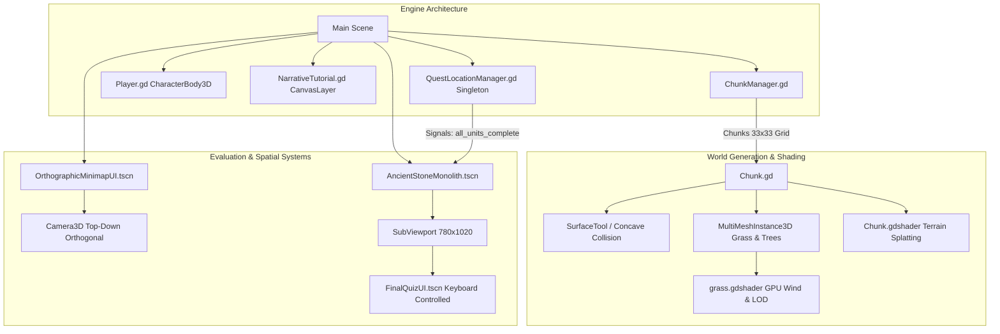

# SublimeGreens: Architectural, Mathematical, and Algorithmic Compendium

**SublimeGreens** is an interactive, real-time 3D educational environment developed in **Godot Engine 4 (GDScript / GLSL Shading Language)**. It bridges theoretical Computer Graphics and Virtual Reality (CGVR) curriculum topics—such as procedural generation, affine transformations, rasterization pipelines, shading models, GPU hardware instancing, and viewing pipelines—with active experiential learning and spatial evaluation.

---

## 1. System Architecture & Component Hierarchy

The project decouples real-time world generation, player kinematics, GPU graphics execution, and educational pedagogic loops through an event-driven scene graph.



---

## 2. Core Mathematical Formulations & Algorithms

### 2.1 Procedural Terrain Generation & Multi-Octave Noise Synthesis
Terrain elevation $H(x, z)$ is generated as a composite multi-frequency field using coherent gradient simplex noise (FastNoiseLite):

$$H(x, z) = H_{\text{continent}}(x, z) + M(x, z) \cdot H_{\text{mountain}}(x, z) - V(x, z) + E(x, z)$$

Where:
- $H_{\text{continent}}(x, z)$: Low-frequency base elevation scaled between $[-10.0, 25.0]$.
- $M(x, z) = \text{clamp}\left(\frac{H_{\text{continent}} - h_{\text{start}}}{h_{\text{fade}}}, 0, 1\right)$: Smoothstep altitude mask restricting mountainous terrain to higher ground.
- $H_{\text{mountain}}(x, z)$: High-amplitude fractal noise ($A = 40.0$).
- $V(x, z)$: Valley carving subtraction applied where elevation exceeds threshold $5.0$.
- $E(x, z)$: High-frequency erosion roughness noise ($A = 2.5$).

```gdscript
# Code Snippet: Chunk.gd (Terrain Height Synthesis)
var c_val = noise_continent.get_noise_2d(wx, wz) * continent_slope_scale
var m_mask = clamp((c_val - mountain_start_height) / mountain_fade_height, 0.0, 1.0)
var m_val = noise_mountain.get_noise_2d(wx, wz) * mountain_scale * m_mask
var v_val = 0.0
if c_val > valley_apply_threshold:
    v_val = abs(noise_valley.get_noise_2d(wx, wz)) * valley_carve_scale
var e_val = noise_erosion.get_noise_2d(wx, wz) * erosion_scale
var final_y = c_val + m_val - v_val + e_val
```

### 2.2 Analytical Surface Normal Generation & Lighting
Lighting evaluation in the fragment shader requires per-vertex surface normals $\mathbf{N}$. SurfaceTool generates these via discrete cross products of adjacent triangle edge vectors:

$$\mathbf{v}_a = \mathbf{p}_1 - \mathbf{p}_0, \quad \mathbf{v}_b = \mathbf{p}_2 - \mathbf{p}_0$$
$$\mathbf{N}_{\text{unnormalized}} = \mathbf{v}_a \times \mathbf{v}_b = \begin{bmatrix} (v_{ay} v_{bz} - v_{az} v_{by}) \\ (v_{az} v_{bx} - v_{ax} v_{bz}) \\ (v_{ax} v_{by} - v_{ay} v_{bx}) \end{bmatrix}, \quad \mathbf{N} = \frac{\mathbf{N}_{\text{unnormalized}}}{\|\mathbf{N}_{\text{unnormalized}}\|}$$

In the terrain fragment shader (`Chunk.gdshader`), texture splatting blends rock/slope against grass based on normal elevation $\mathbf{N}_y$:

$$\alpha_{\text{slope}} = \text{smoothstep}(\text{slope\_threshold} - \Delta_s, \text{slope\_threshold} + \Delta_s, \mathbf{N}_y)$$
$$\mathbf{C}_{\text{final}} = \text{mix}(\mathbf{C}_{\text{slope}}, \mathbf{C}_{\text{height}}, \alpha_{\text{slope}})$$

### 2.3 GPU Wind Dynamics via Procedural Vertex Displacement
Individual grass blades deform dynamically without CPU intervention. The vertex shader evaluates a traveling noise wave using the instance world position $\mathbf{p}_{\text{instance}} = \mathbf{M}[3].xyz$:

$$\mathbf{u}_{\text{wind}} = \mathbf{p}_{\text{instance}.xz} \cdot s_{\text{scale}} + t \cdot v_{\text{speed}} \cdot \hat{\mathbf{d}}_{\text{wind}}$$
$$\text{offset} = (2 \cdot \text{noise}(\mathbf{u}_{\text{wind}}) - 1) \cdot A_{\text{strength}} \cdot (1 - \text{UV}_y)$$
$$\mathbf{p}'_{\text{world}} = \mathbf{p}_{\text{world}} + \begin{bmatrix} \hat{d}_{\text{wind}.x} \\ 0 \\ \hat{d}_{\text{wind}.y} \end{bmatrix} \cdot \text{offset}$$
$$\mathbf{v}_{\text{local}} = \mathbf{M}^{-1} \begin{bmatrix} \mathbf{p}'_{\text{world}} \\ 1 \end{bmatrix}$$

```glsl
// Code Snippet: grass.gdshader (Vertex Stage)
vec3 instance_world_pos = MODEL_MATRIX[3].xyz;
vec2 wind_uv = instance_world_pos.xz * wind_scale + TIME * wind_speed * normalize(wind_direction);
float noise_value = texture(wind_noise, wind_uv).r * 2.0 - 1.0;
float sway_mask = 1.0 - UV.y; // Root (UV.y = 1) stays anchored; tip (UV.y = 0) bends
float offset_amount = noise_value * wind_strength * sway_mask;
vec3 world_wind_dir = vec3(normalize(wind_direction).x, 0.0, normalize(wind_direction).y);
vec3 new_world_pos = original_world_pos + (world_wind_dir * offset_amount);
VERTEX = (inverse(MODEL_MATRIX) * vec4(new_world_pos, 1.0)).xyz;
```

### 2.4 GPU Hardware Instancing (MultiMesh)
Instead of allocating thousands of SceneTree nodes ($O(N)$ CPU draw calls), MultiMesh packs a 3×4 affine transformation matrix buffer directly into VRAM:

$$\mathbf{T}_{\text{instance}} = \begin{bmatrix} \mathbf{r}_{00} & \mathbf{r}_{01} & \mathbf{r}_{02} & t_x \\ \mathbf{r}_{10} & \mathbf{r}_{11} & \mathbf{r}_{12} & t_y \\ \mathbf{r}_{20} & \mathbf{r}_{21} & \mathbf{r}_{22} & t_z \end{bmatrix}$$

A single draw call (`glDrawElementsInstanced` / Vulkan `vkCmdDrawIndexed`) draws the entire vegetation field.

### 2.5 Axis-Aligned Bounding Box (AABB) Distance & Spatial LOD
Vegetation density scales dynamically using Euclidean distance from the camera $\mathbf{p}_{\text{cam}}$ to the nearest surface point on the chunk's AABB $[\mathbf{b}_{\text{min}}, \mathbf{b}_{\text{max}}]$:

$$\mathbf{p}_{\text{clamped}} = \text{clamp}(\mathbf{p}_{\text{cam}}, \mathbf{b}_{\text{min}}, \mathbf{b}_{\text{max}})$$
$$d_{\text{AABB}} = \|\mathbf{p}_{\text{cam}} - \mathbf{p}_{\text{clamped}}\|$$
$$\text{instance\_count} = N_{\text{total}} \cdot \text{multiplier}(d_{\text{AABB}})$$

### 2.6 Affine Coordinate Transformations (TRS Matrix Pipeline)
Composite transformations obey non-commutative linear algebra:

$$\mathbf{P}' = (\mathbf{T} \times \mathbf{R} \times \mathbf{S}) \times \mathbf{P}$$

$$\begin{bmatrix} x' \\ y' \\ z' \\ 1 \end{bmatrix} = \begin{bmatrix} 1 & 0 & 0 & t_x \\ 0 & 1 & 0 & t_y \\ 0 & 0 & 1 & t_z \\ 0 & 0 & 0 & 1 \end{bmatrix} \begin{bmatrix} \cos\theta & 0 & \sin\theta & 0 \\ 0 & 1 & 0 & 0 \\ -\sin\theta & 0 & \cos\theta & 0 \\ 0 & 0 & 0 & 1 \end{bmatrix} \begin{bmatrix} s_x & 0 & 0 & 0 \\ 0 & s_y & 0 & 0 \\ 0 & 0 & s_z & 0 \\ 0 & 0 & 0 & 1 \end{bmatrix} \begin{bmatrix} x \\ y \\ z \\ 1 \end{bmatrix}$$

### 2.7 2D Orthographic Projection & World-to-Radar Mapping
The bottom-left minimap uses an orthographic projection ($z$-depth division omitted):

$$\begin{bmatrix} x_{\text{ortho}} \\ y_{\text{ortho}} \\ z_{\text{ortho}} \\ 1 \end{bmatrix} = \begin{bmatrix} \frac{1}{\text{size}_x} & 0 & 0 & 0 \\ 0 & \frac{1}{\text{size}_y} & 0 & 0 \\ 0 & 0 & -\frac{2}{f - n} & -\frac{f + n}{f - n} \\ 0 & 0 & 0 & 1 \end{bmatrix} \begin{bmatrix} x_{\text{world}} \\ y_{\text{world}} \\ z_{\text{world}} \\ 1 \end{bmatrix}$$

Radar blip coordinates relative to player forward yaw $\theta_y$:

$$\begin{bmatrix} \Delta x_{\text{radar}} \\ \Delta y_{\text{radar}} \end{bmatrix} = \frac{R_{\text{radar}}}{R_{\text{world}}} \begin{bmatrix} \cos(-\theta_y) & -\sin(-\theta_y) \\ \sin(-\theta_y) & \cos(-\theta_y) \end{bmatrix} \begin{bmatrix} x_{\text{target}} - x_{\text{player}} \\ z_{\text{target}} - z_{\text{player}} \end{bmatrix}$$

---

## 3. Syllabus Mapping (CS373IA CGVR Curriculum)

| Unit | Syllabus Concept | Codebase Implementation | Key Source Files |
| :--- | :--- | :--- | :--- |
| **Unit I** | Primitives, Attributes & Surface Construction | Procedural cuboid trees and triangulated grass mesh generated via vertex and index buffers | `Chunk.gd`, `NarrativeTutorial.gd` |
| **Unit I** | Display Lists & Hardware Batching | MultiMeshInstance3D instanced buffer rendering | `Chunk.gd`, `Main.tscn` |
| **Unit II** | Event-Driven Input & Logical Devices | Keyboard scancode velocity sampling, continuous mouse relative motion deltas | `Player.gd`, `AncientStoneMonolith.gd` |
| **Unit II** | VR Audio & Spatial Attenuation | Kinematic footstep frequency modulation (1.0x to 1.35x sprint pitch scaling) | `Player.gd`, `Player.tscn` |
| **Unit III** | 3D Affine Transformations | Non-commutative TRS matrix pipeline, Euler rotations, and axis-aligned scaling gizmo | `TransformDemoObject.gd`, `Chunk.gd` |
| **Unit III** | Rasterization & Shading Models | Height/slope-dependent procedural texture blending and normal-based diffuse shading | `Chunk.gdshader`, `grass.gdshader` |
| **Unit IV** | 3D Viewing Pipeline & Gimbal Lock | Decoupled 3rd-person SpringArm rig with pitch clamped to $[-90^\circ, +45^\circ]$ | `Player.gd`, `Player.tscn` |
| **Unit IV** | Visible Surface Detection & Back-Face Culling | `cull_back` on solid terrain vs. `cull_disabled` on two-sided grass geometry; AABB distance LOD | `Chunk.gdshader`, `grass.gdshader`, `Chunk.gd` |
| **Unit IV** | Parallel/Orthographic Projection | Top-down Orthogonal Camera3D rendered to SubViewport with custom circular shader mask | `OrthographicMinimap.gd`, `minimap_mask.gdshader` |
| **Unit V** | Procedural VR Modeling | Multi-octave simplex noise terrain with procedural water table plane | `Chunk.gd`, `ChunkManager.gd` |
| **Unit V** | Physical Modeling & Collision Detection | Runtime `ConcavePolygonShape3D` extraction from generated mesh faces; gravity solver | `Chunk.gd`, `Player.gd` |

---

## 4. Academic Formulation & Research Paper Roadmap

If publishing or authoring a research paper derived from this project, consider positioning it in the domain of **Interactive Graphics Pedagogies & Procedural Virtual Environments**.

### 4.1 Recommended Paper Titles
1. *"SublimeGreens: An Immersive, Procedural 3D Environment for Experiential Learning in Computer Graphics and Virtual Reality"*
2. *"Bridging Theory and Real-Time Shaders: A Unified Procedural Pipeline for Interactive Computer Graphics Education"*
3. *"GPU-Driven Instancing and Dynamic Spatial Evaluation in Virtual Learning Environments"*

### 4.2 Proposed Research Questions (Hypotheses)
- **$RQ_1$ (Pedagogical Efficacy):** Does interacting with real-time shader variables (e.g. wind frequency, normal thresholds) improve student comprehension of linear algebra and transformation matrices compared to conventional 2D diagrams?
- **$RQ_2$ (Computational Efficiency):** What are the performance trade-offs (frame times, VRAM footprint, draw calls) between CPU-managed scene graphs versus GPU-instanced MultiMesh pipelines in real-time procedural vegetation?
- **$RQ_3$ (Spatial Evaluation):** Does an in-world spatial assessment (interactive 3D monolith screen with immediate kinetic feedback) yield higher student retention than external web-based quizzes?

### 4.3 Target Publication Venues
- **ACM SIGGRAPH Educator's Forum** (Pedagogical innovation in CG)
- **IEEE Transactions on Learning Technologies (TLT)**
- **IEEE Conference on Virtual Reality and 3D User Interfaces (IEEE VR)**
- **Eurographics - Education Track**
- **Computers & Graphics (Elsevier)**

---

## 5. Reference Research Papers & Academic Literature

### Seminal Procedural & Shading Foundations
1. **Perlin, K. (1985).** *An image synthesizer.* ACM SIGGRAPH Computer Graphics, 19(3), 287-296.  
   *(Foundational paper defining procedural gradient noise for natural surfaces).*
2. **Perlin, K. (2001).** *Noise hardware.* Real-Time Shading SIGGRAPH Course Notes.  
   *(Introduced Simplex Noise, reducing computational complexity from $\mathcal{O}(2^n)$ to $\mathcal{O}(n^2)$).*
3. **Ebert, D. S., Musgrave, F. K., Peachey, D., Perlin, K., & Worley, S. (2003).** *Texturing & Modeling: A Procedural Approach.* Morgan Kaufmann.  
   *(The definitive text on multi-octave terrain synthesis, fractal Brownian motion, and erosion).*

### Real-Time Vegetation, GPU Instancing & LOD
4. **Pelzer, K. (2004).** *Rendering countless blades of waving grass.* GPU Gems, 1, 107-121. Addison-Wesley.  
   *(Pioneered real-time vertex shader wind animation and billboard/blade hybrid instancing).*
5. **Boulanger, K., Bouatouch, K., & Sumanta, P. (2006).** *Real-time realistic rendering of nature scenes with dynamic lighting: grass and trees.* ACM SIGGRAPH Computer Graphics.
6. **Akenine-Möller, T., Haines, E., & Hoffman, N. (2018).** *Real-Time Rendering (4th Edition).* CRC Press.  
   *(Comprehensive treatment of affine matrix pipelines, bounding volumes, and visible surface detection).*

### Virtual Reality Education & Interactive Systems
7. **Dalgarno, B., & Lee, M. J. (2010).** *What are the learning affordances of 3-D virtual environments?* British Journal of Educational Technology, 41(1), 10-32.
8. **Mayer, R. E. (2014).** *Cognitive theory of multimedia learning.* The Cambridge Handbook of Multimedia Learning, 43-71.  
   *(Theoretical grounding for dual-channel visual-kinesthetic learning in 3D worlds).*
9. **Freina, L., & Ott, M. (2015).** *A literature review on immersive virtual reality in education: state of the art and perspectives.* Proceedings of eLearning and Software for Education (eLSE).
